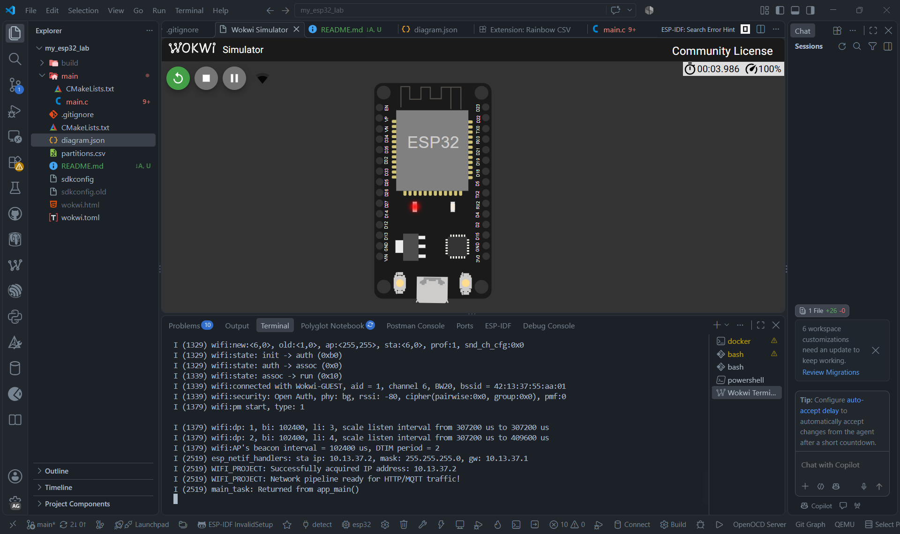
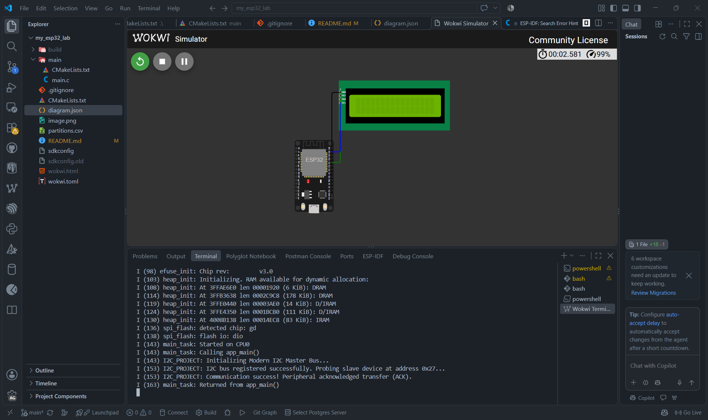

# 🚀 Module 1 & Module 2: ESP32 Embedded Systems Lab

**น.ส.ชญานิศ ธีรเวโรจน์**   
**รหัสนักศึกษา:** 68030349

---

## 📌 Project Overview

โปรเจกต์นี้เป็นห้องปฏิบัติการจำลองการทำงานบนบอร์ด **ESP32 DevKit v1** โดยใช้เฟรมเวิร์ก **ESP-IDF** และทำการทดสอบระบบผ่าน **Wokwi Simulator** บน VS Code / Wokwi CLI

### 🛠️ Key Technologies & Environment
* **Microcontroller:** ESP32 (ESP-IDF v5.x / v6.x)
* **Development Tool:** Visual Studio Code / Docker (Espressif IDF container)
* **Simulator:** Wokwi Simulator & Wokwi CLI

---

## 📶 Module 1: Wi-Fi Station Pipeline

สร้างระบบเชื่อมต่อ Access Point (`Wokwi-GUEST`) และขอรับหมายเลข IP Address อัตโนมัติ เพื่อเตรียมความพร้อมสำหรับ HTTP/MQTT Traffic

### 🎯 Test Results & Execution Output
เมื่อระบบเริ่มต้นทำงานและทำการดึง IP Address จาก DHCP ได้สำเร็จ จะแสดงข้อความยืนยันสถานะตามรูป ดังนี้:

---

## 🔌 Module 2: Native I2C Master Interface

ตั้งค่า ESP32 เป็น **I2C Master Bus** ด้วยไดรเวอร์ `driver/i2c_master.h` เพื่อสื่อสารกับบอร์ดไดรฟ์จอ LCD1602 (PCF8574 Backpack) ที่แอดเดรส **`0x27`**

### 🛠️ Hardware Pin Connection Mapping
| ESP32 Pin | Peripherals (LCD1602) | Signal Function | Config |
| :---: | :---: | :---: | :---: |
| **GPIO 21** | SDA | I2C Serial Data | Internal Pull-Up Enabled |
| **GPIO 22** | SCL | I2C Serial Clock (100 kHz) | Internal Pull-Up Enabled |
| **5V** | VCC | Power Supply (+5V) | - |
| **GND** | GND | Common Ground | - |

### 🎯 Test Results & Execution Output
เมื่อระบบเริ่มต้นทำงานและสามารถสื่อสารกับจอ LCD ผ่าน I2C บัสได้สำเร็จ จะได้รับสัญญาณตอบรับ (ACK) จากอุปกรณ์ ดังนี้:

